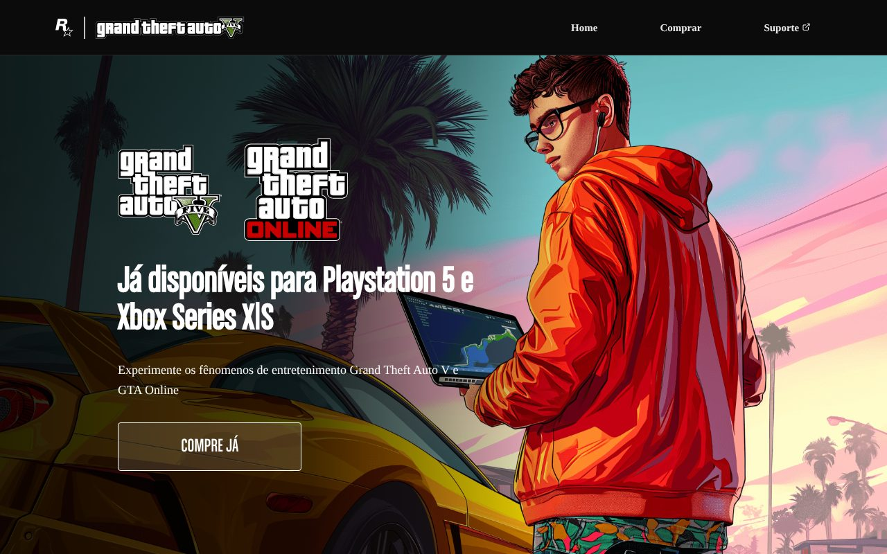
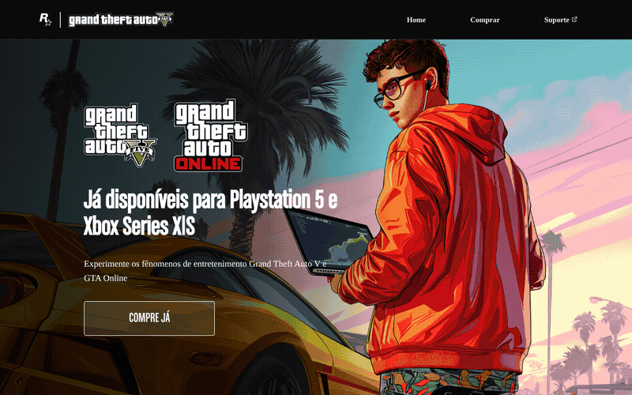

# 🚗 Projeto GTA — Landing page de lançamento do GTA V

Landing page estática inspirada no lançamento de **Grand Theft Auto V e GTA Online** para a nova geração de consoles, feita para praticar **HTML, CSS e JavaScript**.

🔗 **Acesse online:** [pimenta15.github.io/Projeto-GTA](https://pimenta15.github.io/Projeto-GTA/)

<p align="center">
  
</p>

## ✨ O que tem na página

| Parte | Descrição |
|---|---|
| **Cabeçalho** | Logos Rockstar/GTA e navegação (Home, Comprar, Suporte) |
| **Hero** | Arte de fundo, logos do GTA V e GTA Online e botão "Compre já" |
| **Compre já** | Seção com as plataformas disponíveis |
| **Seletor de plataforma** | Botão que abre/fecha a lista de plataformas com JavaScript (`classList.toggle`) |

<p align="center">
  
</p>

## 🚀 Como executar

Não precisa de build: basta abrir o `index.html` no navegador.

```bash
git clone https://github.com/Pimenta15/Projeto-GTA.git
cd Projeto-GTA
# abra index.html no navegador (ou use a extensão Live Server)
```

## 📁 Estrutura

```
index.html
src/
├── css/      # reset.css, fontes.css, estilos.css
├── fontes/   # fontes customizadas
├── imagens/  # logos (SVG), fundos e arte dos personagens
└── js/       # index.js — interação do seletor de plataformas
```

## 🛠️ Tecnologias


> Projeto de estudo, sem fins comerciais. GTA, Grand Theft Auto e Rockstar Games são marcas de seus respectivos donos.

---

Feito por [João Pedro Pimenta](https://www.linkedin.com/in/joao-pedro-pimenta/) durante a graduação em Ciência da Computação na UNICAP.
